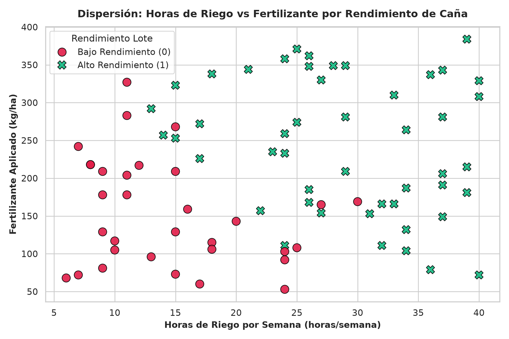
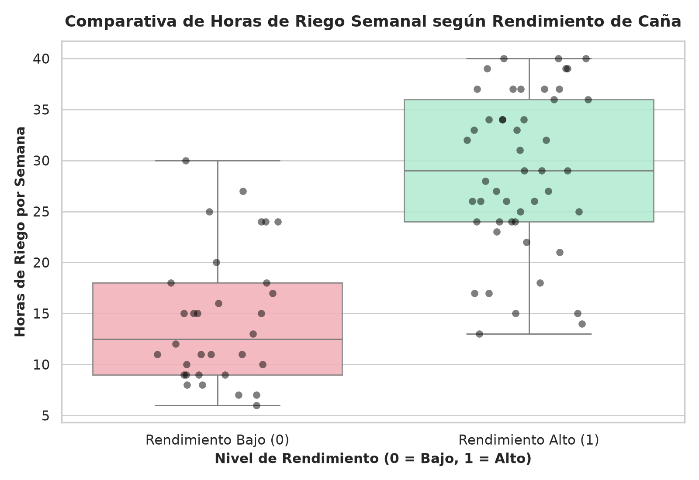
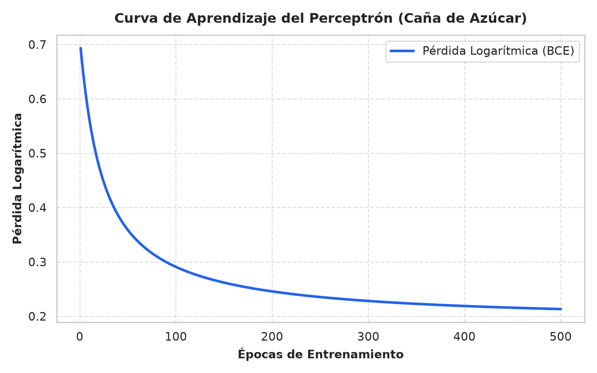
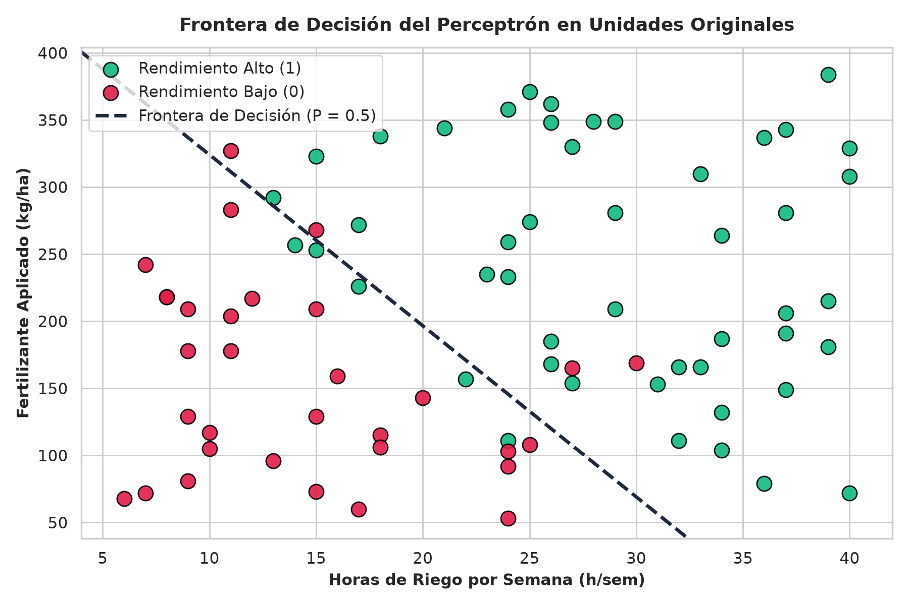

# Segundo Parcial - Inteligencia Artificial: Perceptrón y Limpieza de Datos

**COTECNOVA — Corporación de Estudios Tecnológicos del Norte del Valle**  
**Tecnología en Gestión de Sistemas de Información — Semestre VI (2026-02)**  
**Docente:** Jhon James Cano Sánchez  
**Integrantes (Grupo 02):** Brandon Cortes Giraldo & Johan Sttive Linares Barragán  
**Tema Asignado:** Caña de Azúcar – Rendimiento de Lotes en Cartago y el Norte del Valle  
**Archivo de Datos:** `grupo_02.csv`  
**Contenedor Docker:** `parcial2_ia`  

---

## 1. De qué trata este parcial y nuestro caso
Para este segundo parcial, nos pusieron en el papel de consultores de IA para ayudar a resolver un problema clave en nuestra región: la caña de azúcar en Cartago y el Valle del Cauca. La idea es que a partir de los datos que nos entregaron en bruto (`grupo_02.csv`), logremos predecir si un lote va a dar un **Rendimiento Alto (`1`)** o un **Rendimiento Bajo (`0`)** fijándonos en dos cosas que maneja el agricultor en el campo:
* **`horas_riego_semana` ($x_1$):** Las horas de agua que le echan al lote por semana.
* **`fertilizante_kg_ha` ($x_2$):** Los kilos de abono o fertilizante que le aplican por hectárea.

Todo el parcial lo trabajamos desde cero: primero limpiamos los datos con **Pandas**, sacamos las gráficas con **Seaborn** y luego montamos a mano la neurona artificial (**Perceptrón con sigmoide y descenso del gradiente**) usando **NumPy**, sin usar librerías automáticas como Scikit-Learn, tal cual como lo vimos en la Clase 9.

---

## 2. Configuración del Entorno con Docker (Tarea 1)

Para que el profesor o cualquier persona pueda correr este proyecto sin enredos de versiones, empaquetamos todo dentro de Docker con Python 3.12, dejando el contenedor con el nombre `parcial2_ia`.

### Comandos para clonar y poner a correr todo:

```bash
# 1. Clonar nuestro repositorio de GitHub
git clone https://github.com/Brandon07-code/parcial2-ia-grupo02.git
cd parcial2-ia-grupo02

# 2. Levantar el contenedor en segundo plano
docker compose up -d --build

# 3. Correr el script del parcial con todo el proceso (limpieza, gráficas y perceptrón)
docker exec -it parcial2_ia python src/parcial2.py
```

### Estructura de carpetas que armamos:
```text
parcial2-ia-grupo02/
├── Dockerfile
├── docker-compose.yml
├── requirements.txt
├── .gitignore
├── README.md
├── dispersion_riego_fertilizante.png
├── boxplot_riego_rendimiento.png
├── curva_aprendizaje.png
├── frontera_decision.png
├── data/
│   ├── grupo_02.csv           # El archivo original tal como nos lo pasó el profe
│   └── grupo_02_limpio.csv    # El archivo ya depurado y listo para la neurona
└── src/
    └── parcial2.py            # Nuestro código fuente completo
```

---

## 3. Carga e Inspección de los Datos (Tarea 2)

Apenas abrimos el archivo `data/grupo_02.csv` con Pandas en el script `src/parcial2.py`, nos pusimos a revisar qué nos habían entregado:

1. **Tamaño del archivo (`shape`):** Llegó con 85 filas y 5 columnas.
2. **Las 5 primeras filas (`head()`):**
```text
  lote_id            vereda  horas_riego_semana fertilizante_kg_ha  rendimiento_alto
0    C001             Cauca                11.0                204               0.0
1    C002         Coloradas                26.0                348               1.0
2    C003  Piedras de Moler                34.0                264               1.0
3    C004             Cauca                15.0                 73               0.0
4    C005          Zaragoza                29.0                281               1.0
```
3. **Tipos de datos detectados:**
   * `lote_id`: texto (`object`).
   * `vereda`: texto (`object`), con sectores conocidos de la zona como Cauca, Coloradas, Piedras de Moler, Zaragoza y Modín.
   * `horas_riego_semana`: decimal (`float64`).
   * `fertilizante_kg_ha`: texto (`object`) -> **¡Aquí pillamos el primer problema!**
   * `rendimiento_alto`: decimal (`float64`).
4. **Valores nulos (`isnull().sum()`):**
   * 1 nulo en `vereda` (en la última fila).
   * 3 nulos en `horas_riego_semana` (lotes `C045`, `C067` y `C071`).
   * 1 nulo en `rendimiento_alto` (en la última fila).
5. **Filas duplicadas:** Encontramos 4 registros repetidos.

### Pregunta Clave de la Tarea 2:
> **¿Alguna columna numérica aparece con un tipo de dato que no debería tener? ¿Por qué ocurre?**
>
> **Respuesta:** Sí señor, la columna `fertilizante_kg_ha`. Debería ser un número entero o decimal para poder hacer cálculos, pero Pandas la leyó como texto (`object`).  
> **¿Por qué pasó esto?:** Porque la persona que estaba digitando los datos en la finca le dio por escribir la unidad `"kg"` al lado del número en varias filas (por ejemplo en el lote `C008` puso `"371 kg"`, en el `C032` puso `"215 kg"` y en el `C038` puso `"257 kg"`). Como Pandas ve letras revueltas con números, asume que toda la columna es texto y no nos deja hacer operaciones matemáticas hasta que le quitemos esas letras.

---

## 4. Limpieza y Calidad de Datos con Pandas (Tarea 3)

Revisando el dataset con lupa encontramos **4 problemas de calidad** bien claros y los solucionamos así:

### Los 4 problemas que corregimos:

1. **La fila de resumen al final (`TOTAL`):**
   * *Qué pasaba:* En la fila 84 alguien metió un resumen que decía `lote_id = TOTAL`, con `1867.0` horas de riego y `16421.0` kilos de fertilizante.
   * *Decisión:* La eliminamos de una con `df[df['lote_id'] != 'TOTAL']`.
   * *Por qué:* Eso no es ningún lote sembrado, es una suma total que metieron en el Excel. Si la dejamos, nos revienta el promedio y nos daña el modelo de IA.
2. **El texto `"kg"` metido en el fertilizante:**
   * *Qué pasaba:* Lotes como el `C008`, `C032` y `C038` tenían la palabra `"kg"`.
   * *Decisión:* Le quitamos el `"kg"` con `.str.replace('kg', '')`, borramos espacios en blanco y convertimos la columna a `float64`.
   * *Por qué:* Así recuperamos el número real sin perder la información de esos lotes.
3. **Valores vacíos (`NaN`) en horas de riego:**
   * *Qué pasaba:* Los lotes `C045` (en el Cauca), `C067` (en Zaragoza) y `C071` (en Coloradas) no tenían registrado el riego.
   * *Decisión:* Les imputamos la **mediana** de las horas de riego, que nos dio exactamente **`24.0 horas/semana`**.
   * *Por qué:* No queríamos botar esos 3 lotes a la basura porque entre más datos tengamos, mejor aprende la neurona. Usamos la mediana en vez de la media para no dejarnos sesgar por números extremos.
4. **Filas duplicadas en el sistema:**
   * *Qué pasaba:* Había 4 lotes que estaban metidos dos veces con los mismos datos (`C022`, `C051`, `C060` y `C073`).
   * *Decisión:* Borramos los duplicados con `df.drop_duplicates(subset=['lote_id'])`, dejando solo la primera vez que aparecían.
   * *Por qué:* Si dejamos filas repetidas, la neurona le va a dar el doble de importancia a esos lotes por pura trampa del archivo.

### Resumen del antes y después:
* **Filas al inicio:** 85 filas (84 registros + la fila del `TOTAL`).
* **Filas al final (limpias):** 80 lotes reales.
* **Filas eliminadas:** 5 en total (1 de resumen + 4 duplicados).
* **Cómo quedaron las clases:**
  * **Alto Rendimiento (`1`):** 48 lotes (**60.0%**).
  * **Bajo Rendimiento (`0`):** 32 lotes (**40.0%**).
* El archivo limpio lo guardamos en: `data/grupo_02_limpio.csv`.

### Pregunta Clave de la Tarea 3:
> **¿Qué valor le pareció más sospechoso? Calcular la media de esa columna antes y después de corregirlo y explicar cómo habría afectado el escalado del perceptrón si no se hubiera corregido.**
>
> **Respuesta:** El valor más sospechoso y peligroso de todos fue el número **`16421.0 kg`** de fertilizante que venía en la fila de `TOTAL` (junto con las `1867.0` horas de riego).  
>
> * **La media antes y después en el fertilizante:**
>   * *Media con el error (incluyendo la fila TOTAL):* **`400.51 kg/ha`**.
>   * *Media real corregida (sin la fila TOTAL y con los datos limpios):* **`207.50 kg/ha`**.  
>   *(¡Casi el doble de diferencia! Un desfase de más del 93%).*
>
> * **Cómo hubiera dañado el escalado del perceptrón:**  
>   Recordemos que para estandarizar los datos le restamos la media y dividimos por la desviación: $x_{norm} = \frac{x - \mu}{\sigma}$.  
>   Si hubiéramos dejado ese valor de 16.421, la media se sube a 400 y la desviación se infla horrible. Entonces, todos los lotes normales (que aplican entre 50 y 380 kg) habrían quedado con números negativos chiquiticos todos apretados contra el cero, mientras que ese solo dato de 16.421 se quedaba por allá botado a más de 15 desviaciones estándar. La neurona se hubiera vuelto loca intentando acomodarse a ese punto loco y no habría aprendido a clasificar los lotes reales ni de chiste.

---

## 5. Visualizaciones con Seaborn (Tarea 4)

Hicimos los dos gráficos que pidió el profe usando Seaborn y quedaron guardados como imágenes en el proyecto:

### Gráfico 1: Dispersión de Riego vs Fertilizante (`dispersion_riego_fertilizante.png`)


* **Qué muestra:** Compara frente a frente las dos variables numéricas (`horas_riego_semana` abajo y `fertilizante_kg_ha` al lado), pintando en **verde los lotes de Alto Rendimiento (1)** y en **rojo los de Bajo Rendimiento (0)**.
* **Qué concluimos:** Se ve clarito que hay una separación diagonal muy buena. Los lotes a los que les va bien (verde) están todos arriba a la derecha: tienen buen riego (más de 20-25 horas semanales) y buen abono (más de 180-200 kg/ha). Si a un lote le falta agua o le falta comida, de una cae en la zona roja de bajo rendimiento.

### Gráfico 2: Diagrama de Caja de Horas de Riego (`boxplot_riego_rendimiento.png`)


* **Qué muestra:** Un gráfico de cajas y bigotes que compara cuántas horas de riego reciben los lotes malos (`0`) frente a los lotes buenos (`1`).
* **Qué concluimos:** La diferencia es abismal. La mediana de los lotes de bajo rendimiento es de apenas **11.5 horas de riego a la semana**, mientras que los lotes de alto rendimiento tienen una mediana de **31.0 horas/semana**. Las cajas ni siquiera se tocan, lo que nos demuestra que el agua es el factor más determinante para que la caña pegue bien en la región.

---

## 6. Perceptrón desde Cero con NumPy (Tarea 5)

Siguiendo las fórmulas de la Clase 9, armamos la neurona a pie, sin paquetes mágicos:

1. **Estandarizamos las entradas ($Z$-score):**
   * Riego: Media = **23.11 h/sem**, Desviación = **10.08**
   * Fertilizante: Media = **207.50 kg/ha**, Desviación = **91.97**
2. **Función Sigmoide:** $\sigma(z) = \frac{1}{1 + e^{-z}}$, donde $z = w_1 x_{norm1} + w_2 x_{norm2} + b$.
3. **Pérdida Logarítmica (Binary Cross-Entropy):** Calculada con logaritmos naturales para medir qué tan castigada estaba la predicción frente a la realidad.
4. **Entrenamiento con Descenso del Gradiente:** Usamos una tasa de aprendizaje $\alpha = 0.1$ y lo pusimos a rodar durante **500 épocas**.

### Resultados del Aprendizaje:

```text
Al inicio (Época 0):
  • Pesos arrancando: w1 = 0.0, w2 = 0.0, b = 0.0
  • Pérdida inicial : 0.6931 (que es exactamente ln(2), lo normal cuando no sabe nada)
  • Exactitud inicial: 60.00% (apenas acertaba por la clase mayoritaria)

Al final (Época 500):
  • Peso w1 (Horas de Riego)   : +2.6531
  • Peso w2 (Fertilizante)      : +1.8984
  • Sesgo b                    : +1.0431
  • Pérdida final              : 0.2132 (bajó 0.48 unidades, una curva limpiecita)
  • Exactitud final            : 88.75% (le pegó a 71 de los 80 lotes)
```

### Gráficas de la Neurona:

#### Curva de Aprendizaje (`curva_aprendizaje.png`)

Muestra cómo el error fue cayendo en picada durante las primeras 100 épocas y luego se estabilizó suavemente alrededor de la época 350 en 0.21. No hubo saltos raros ni oscilaciones, lo que prueba que el paso de aprendizaje ($\alpha = 0.1$) estuvo en el punto exacto.

#### Frontera de Decisión (`frontera_decision.png`)

Para que esto le sirva de verdad a un agrónomo en el campo, no dejamos la línea en números abstractos, sino que despejamos la recta $z = 0$ para dibujarla en las unidades reales de Cartago:
$$\text{fertilizante} = \mu_2 - \sigma_2 \left( \frac{w_1 \frac{\text{riego} - \mu_1}{\sigma_1} + b}{w_2} \right)$$
La línea punteada separa con mucha precisión la nube verde de la roja.

---

## 7. Interpretación de Resultados (Tarea 6)

### 1. ¿Qué significa el signo de $w_1$ y de $w_2$? ¿Tiene sentido para Cartago?
* **Peso $w_1 = +2.6531$ (Riego):** Es positivo. Significa que entre más horas de riego reciba el lote a la semana, más se dispara la probabilidad de que la cosecha sea de alto rendimiento. Además, como es más grande que $w_2$ ($2.65$ frente a $1.90$), la neurona descubrió que el agua pesa más que el abono.
* **Peso $w_2 = +1.8984$ (Fertilizante):** También es positivo. Nos dice que meterle buen fertilizante al suelo también empuja el rendimiento para arriba.
* **Sentido en nuestra región:** Tiene toda la lógica del mundo. La caña de azúcar en el clima cálido del Valle necesita agua constante para crecer y engrosar el tallo. Si no hay agua, el abono se queda seco en la tierra y la planta no lo puede chupar. Por eso el riego manda la parada.

### 2. Según la frontera de decisión, ¿los datos son linealmente separables? ¿Cuántos quedaron mal?
* Sí, los datos son **bastante bien separables con una sola línea recta**. No hay patrones en círculo ni cosas raras.
* Con una exactitud del **88.75%**, apenas **9 de los 80 lotes (11.25%)** quedaron del lado equivocado de la línea. Son lotes límite que, por ejemplo, tuvieron buen riego pero de pronto sufrieron de mal drenaje o plagas y no alcanzaron el rendimiento esperado.

### 3. Prueba con Dos Casos Nuevos Inventados

Nos inventamos dos lotes realistas para ver cómo reaccionaba el modelo entrenado:

| Lote de Prueba | Condiciones en Campo | Probabilidad de la Neurona | Decisión Final | ¿Coincide con lo esperado? |
|---|---|---|---|---|
| **Lote 1 (Bien trabajado)** | **35 h/sem riego**, **300 kg/ha fertilizante** | **99.77%** | **Alto Rendimiento (`1`)** | Totalmente. Con semejante cantidad de agua y comida, es casi fijo que rinde. |
| **Lote 2 (Abandonado)** | **8 h/sem riego**, **80 kg/ha fertilizante** | **0.38%** | **Bajo Rendimiento (`0`)** | Totalmente. Ese lote en sequía y desnutrido está condenado a bajo rendimiento. |

### 4. Recomendación concreta a la entidad local (con números del parcial)
Con los resultados en mano, le recomendamos a la entidad o al ingenio dos medidas claras:
1. **Fijar una meta mínima de 22.5 horas de riego semanales:** En los datos se vio que los lotes con menos de **16 horas/semana** fracasaron casi todos. Si quieren subir la producción en veredas como Coloradas o Zaragoza, hay que meterles distritos de riego para que no dependan solo de que llueva.
2. **No bajar la fertilización de 180 kg/ha:** La frontera matemática nos demostró que incluso con buen riego (25 horas), si le echan menos de **180 kg/ha** de abono, el lote cae por debajo del 50% de probabilidad de éxito.

### 5. Limitaciones que tiene este modelo en la vida real
Aunque el perceptrón dio un 88.75% de acierto, en una finca real hay que tener cuidado con dos cosas:
1. **Asume que más siempre es mejor (linealidad estricta):** El perceptrón cree que si le metemos 100 horas de agua y 1.000 kg de fertilizante va a rendir el triple, pero en la realidad el exceso de agua ahoga la caña y el exceso de químico quema las raíces y daña la tierra.
2. **Le faltan variables ambientales:** No le metimos datos del tipo de suelo (si es greda o arena), plagas como el barrenador (*Diatraea*), la variedad de la semilla ni los días de sol.

---

## 8. Repositorio y Commits en GitHub (Tarea 7)

* **Enlace público:** https://github.com/Brandon07-code/parcial2-ia-grupo02
* **Historial de los 5 commits realizados:**
  1. `Tarea 1: configuracion inicial del entorno Docker y estructura del proyecto`
  2. `Tareas 2 y 3: carga, inspeccion y limpieza de datos con Pandas`
  3. `Tarea 4: visualizaciones estadisticas avanzadas con Seaborn`
  4. `Tarea 5: implementacion del perceptron desde cero con NumPy y graficas de convergencia`
  5. `Tareas 6 y 7: analisis e interpretacion de resultados y documentacion final`
